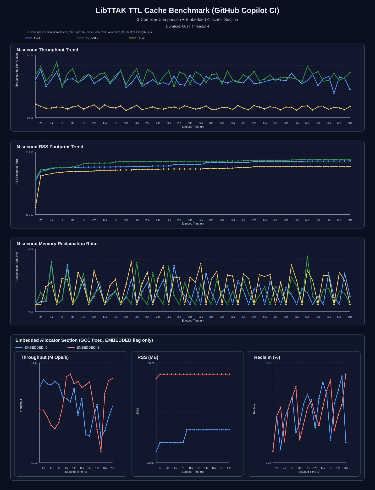

# libttak



[Book](http://github.com/c4punks/libttak-books)

**Deterministic systems runtime for C.**

libttak is a low-level runtime focused on predictable memory behavior,
high-throughput concurrency, and deterministic resource scheduling.

It powers higher-level systems such as:

- custom web frameworks
- network routing layers
- lock-free ingress pipelines
- containerized services
- experimental overlay networking systems

This project intentionally avoids treating memory allocation,
network scheduling, and concurrency as isolated subsystems.

Instead, libttak attempts to unify them under deterministic control.

---

## Why this exists

Traditional C applications often fail in predictable ways under scale:

- fragmented heap growth
- allocator contention
- unstable tail latency
- difficult async coordination
- inconsistent resource ownership

libttak was built to reduce those failure modes.

It provides explicit lifecycle control while preserving high throughput.

---

# Core Components

## Memory

### Generational Arena

Batched allocations with explicit generation cleanup.

- timestamped generations
- bulk reclamation
- predictable cleanup boundaries

---

### Epoch Reclamation

Cross-thread memory reclamation without global pauses.

- retire lists
- quiescence checks
- delayed safe reclamation

---

### Ownership Model

Explicit ownership semantics for long-lived allocations.

- detachable allocations
- owner tracking
- VMA-backed regions
- fast-path allocation shortcuts

---

## Concurrency

### Futures / Promises / Tasks

Internal async primitives:

- futures
- promises
- task scheduling
- worker coordination

---

### Thread Pools

Explicit worker orchestration without hiding scheduling behavior.

---

## Networking

### Deterministic Lattice Scheduler

This is one of libttak's experimental scheduling layers.

It uses deterministic coordinate selection inspired by
orthogonal Latin square (OLS) constructions.

This is used for:

- parallel ingress balancing
- contention reduction
- deterministic slot routing
- burst dispersion

This is **not marketed as formal academic MOLS research**.

It is a systems scheduling experiment inspired by historical
construction techniques.

---

### Adaptive Burst Prevention

Ingress bursts are detected through weighted routing signals.

The scheduler rotates traffic directions to prevent concentrated hotspots.

---

### Zero-copy IO

- async IO
- sync IO
- zero-copy paths
- platform-aware optimizations

---

## Data Structures

- hash tables
- pools
- ring buffers
- trees
- priority queues
- B+ trees
- schedulers

---

## Math / Acceleration

libttak includes optional computational modules:

- bigint
- bigreal
- matrix operations
- NTT
- CUDA
- OpenCL
- ROCm acceleration

These modules are optional and isolated from core runtime usage.

---

# Performance

## CI Benchmark (Reproducible Baseline)

The public benchmark shown below runs in GitHub CI because it is fully reproducible.

Environment:

- GitHub Actions / Copilot CI
- KVM virtualized environment
- Intel Xeon Platinum 8272CL
- 3 vCPU
- 17 GB RAM

Benchmark target:

`bench/ttl-cache-multithread-bench/ttl_cache_bench_lockfree`

Configuration:

- 60 second runtime (compiler comparison)
- auto thread detection
- 4 worker threads
- 1 maintenance thread

Results (GCC):

- Peak throughput: **27.13M ops/sec**
- Average throughput: **20.00M ops/sec**
- Final RSS: **~579.3 MB**

Results (Clang):

- Peak throughput: **27.11M ops/sec**
- Average throughput: **20.91M ops/sec**
- Final RSS: **~579.4 MB**

Results (TCC):

- Peak throughput: **14.89M ops/sec**
- Average throughput: **11.41M ops/sec**
- Final RSS: **~578.9 MB**

These numbers should be treated as a **minimum reproducible baseline**, not peak hardware capability.

CI runners introduce:

- virtualization overhead
- noisy neighbors
- inconsistent CPU scheduling
- lower sustained boost behavior

:contentReference[oaicite:0]{index=0}

---

## Bare Metal Benchmark

On physical Ryzen servers, the same benchmark has already reached
the throughput numbers referenced in earlier internal documentation
without CI virtualization penalties.

Bare-metal runs consistently outperform GitHub CI due to:

- higher sustained clocks
- better cache behavior
- no hypervisor scheduling overhead
- more stable thread placement

The CI benchmark remains published because anyone can reproduce it.

The Ryzen benchmark reflects real deployment behavior.

---

# Microcontrollers (Bare Metal)

libttak cross-builds for Cortex-M microcontrollers running newlib without
an OS:

```sh
make PLATFORM=baremetal                                   # Cortex-M7 (default)
make PLATFORM=baremetal MCU_FLAGS="-mcpu=cortex-m4 -mthumb -mfloat-abi=hard -mfpu=fpv4-sp-d16"
```

This produces `lib/libttak.a` built with `-DTTAK_PLATFORM_BAREMETAL=1 -DEMBEDDED=1`;
compile your firmware with the same two defines.

What changes on bare metal:

- **Single-threaded.** pthread calls map to stubs; `pthread_create` fails
  with `ENOSYS`, so thread pools cannot start. Async scheduling falls back to
  running tasks inline.
- **Static memory.** Allocations come from fixed `.bss` pools (about 140 KiB
  by default). Tune them with `TTAK_EMBEDDED_POOL_ORDER` (buddy pool, default
  16 = 64 KiB), `TTAK_VMA_REGION_SIZE` and `TTAK_POCKET_PAGE_COUNT`.
  `ttak_mem_buddy_get_stats()` reports the buddy pool's usage and its largest
  free block, so you can see fragmentation.
- **8-byte alignment.** `ttak_mem_alloc()` returns 8-byte aligned memory
  (64 on hosted builds) so that small objects keep small headers. Build the
  library and firmware with `-DTTAK_MEM_HEADER_ALIGN=32` if buffers must sit
  on Cortex-M7 cache lines, e.g. for DMA.
- **Clock.** Timing uses the DWT cycle counter scaled by
  `ttak_platform_cpu_hz()`, which defaults to 16 MHz. Override it, or
  `ttak_platform_now_ns()` for cores without DWT (Cortex-M0/M0+/M23):

  ```c
  uint32_t ttak_platform_cpu_hz(void) { return SystemCoreClock; }
  ```

- **Not built:** sockets and `poll()` I/O (`net/endpoint`, `net/poller`,
  `net/session`, `net/view`, `io/async`, `io/io`, `io/zerocopy`) unless you
  build with FreeRTOS and lwIP (see [lwIP networking](#lwip-networking)),
  `/proc` statistics, and the `__int128` accelerator backend.

## Stack usage analysis

Bare-metal builds compile with `-fstack-usage` (disable with
`make PLATFORM=baremetal STACK_USAGE=0`), so every object emits a `.su`
file next to it in the `obj/` tree: one line per function with its static
stack frame size in bytes. CI gates these against per-core thresholds
(`.github/workflows/baremetal.yml`) using:

```sh
python3 scripts/baremetal/check_stack_usage.py --core cortex-m7
```

Thresholds live in `scripts/baremetal/stack_usage_thresholds.json`
(20480 B per function on all Cortex-M cores as of this writing). The
check is per-function, not a full call-graph bound — the script also
prints the top-20 largest frames and their total as a recursion proxy.

Measured on current code with `-Os` (frame sizes are nearly identical
across Cortex-M0+/M3/M4F/M33/M7):

| Function | Frame (bytes) |
|---|---|
| `ttak_bigscript_compile` | 18784 |
| `ttak_lsh_process_block` | 6096 |
| `ttak_matrix_invert` | 1648 |
| `ttak_logger_log` | 1048 |
| `ttak_mem_alloc_safe` | 96 |
| `ttak_mem_free` | 56 |
| `tt_create_map` / `tt_ins_map` / `tt_map_get` | 64 / 56 / 24 |
| `ttak_ringbuf_push` / `ttak_ringbuf_pop` | 8 / 8 |

Hot-path entry points (`mem`, `map`, `ringbuf`) stay under 100 B, so a
small RTOS task stack (512 B–1 KiB) is safe as long as it does not call
into the script/matrix/security modules; those need several KiB.

## FreeRTOS

`PLATFORM=freertos` keeps the bare-metal build and adds real threads:
pthread calls run on FreeRTOS tasks, mutexes, and task notifications, so
thread pools, workers, and async scheduling work.

```sh
make PLATFORM=freertos FREERTOS_KERNEL_PATH=/path/to/FreeRTOS-Kernel \
     FREERTOS_CONFIG_DIR=/path/to/your/app   # holds FreeRTOSConfig.h
```

Compile your firmware with `-DTTAK_PLATFORM_BAREMETAL=1 -DTTAK_PLATFORM_FREERTOS=1 -DEMBEDDED=1`.
Your `FreeRTOSConfig.h` needs:

```c
#define configUSE_MUTEXES                        1
#define configSUPPORT_DYNAMIC_ALLOCATION         1
#define configNUM_THREAD_LOCAL_STORAGE_POINTERS  1   /* slot 0: libttak */
#define configTASK_NOTIFICATION_ARRAY_ENTRIES    2   /* last index: libttak */
#define INCLUDE_vTaskDelete                      1
#define INCLUDE_vTaskSuspend                     1
#define INCLUDE_xTaskGetSchedulerState           1
#define INCLUDE_xTaskGetCurrentTaskHandle        1
#define INCLUDE_uxTaskPriorityGet                1
#define configUSE_NEWLIB_REENTRANT               1   /* task-safe printf/errno */
```

- Worker threads get `TTAK_FREERTOS_THREAD_STACK_BYTES` (default 16 KiB) from
  the FreeRTOS heap and inherit the creating task's priority. You can set
  this knob, and the other `TTAK_FREERTOS_*` knobs, in `FreeRTOSConfig.h`.
- Once the scheduler is running, the clock comes from the tick count plus the
  SysTick position within the current tick, so it keeps counting through idle
  periods.
- newlib's `malloc` is made task-safe through `__malloc_lock`.
- Call `ttak_future_release()` on every future from
  `ttak_thread_pool_submit_task()` once you no longer need it. Without it,
  each submission's future and promise stay allocated. This applies on every
  platform, but it matters most with a few hundred KiB of RAM.
  `ttak_mem_usage_bytes()` reports the bytes held by live `ttak_mem`
  allocations, so you can check for growth.

## lwIP networking

`NET=lwip` (with `PLATFORM=freertos`) builds the socket and I/O modules
(`net/endpoint`, `net/poller`, `net/session`, `net/view`, `io/*`) on lwIP's
BSD socket API:

```sh
make PLATFORM=freertos NET=lwip FREERTOS_KERNEL_PATH=... \
     LWIP_PATH=/path/to/lwip LWIP_CONFIG_DIR=/path/to/your/app  # holds lwipopts.h, arch/cc.h
```

Compile your firmware with `-DTTAK_NET_LWIP=1` as well. The application
brings up lwIP as usual: it calls `tcpip_init()` and adds its NIC driver's
netif. libttak only uses sockets. Your `lwipopts.h` needs:

```c
#define LWIP_SOCKET                  1
#define LWIP_COMPAT_SOCKETS          1   /* socket(), poll(), ... -> lwip_*() */
#define LWIP_POSIX_SOCKETS_IO_NAMES  1   /* read(), write(), close() on sockets */
#define LWIP_SOCKET_POLL             1
#define SO_REUSE                     1   /* ttak_net_endpoint_set_reuse */
#define LWIP_SO_RCVBUF               1   /* ttak_net_endpoint_set_buffer_sizes */
```

and `arch/cc.h` should set `LWIP_ERRNO_STDINCLUDE 1` (and, with newlib,
`LWIP_TIMEVAL_PRIVATE 0`) so lwIP reports errors with newlib's errno values.
`tests/baremetal/lwip` has a working configuration.
[`examples/stm32f769i-disco-lwip`](examples/stm32f769i-disco-lwip) runs libttak over the
STM32F769I-DISCO's real Ethernet (HAL ETH driver + LAN8742A). It includes the measured results and the
board bring-up notes.

lwIP differs from POSIX sockets in a few places:

- The send buffer size is fixed at build time (`TCP_SND_BUF`), so
  `ttak_net_endpoint_set_buffer_sizes()` applies only the receive size.
  `SO_REUSEPORT` is not supported.
- `poll()` never reports `POLLHUP`. A closed peer shows up as readable, and
  the read returns 0.
- No `AF_UNIX` sockets or `socketpair()`.
- Lattice acceleration (`TTAK_NET_ROLE_LATTICE_ACCEL`) is off on bare
  metal, because the default lattice takes 256 KiB.

The unit tests run on hardware and in QEMU:

```sh
# QEMU mps2-an500 (Cortex-M7), as in CI
make PLATFORM=baremetal BOARD=mps2_an500 baremetal-tests
scripts/baremetal/run_qemu.sh tests/baremetal/build/mps2_an500/*.elf

# STM32F769I-DISCO over ST-LINK (OpenOCD + virtual COM port)
make PLATFORM=baremetal BOARD=stm32f769i_disco baremetal-tests
scripts/baremetal/run_stm32.py tests/baremetal/build/stm32f769i_disco/*.elf

# FreeRTOS, including the threaded tests (images land in <board>-freertos/)
make PLATFORM=freertos FREERTOS_KERNEL_PATH=... BOARD=mps2_an500 baremetal-tests
scripts/baremetal/run_qemu.sh tests/baremetal/build/mps2_an500-freertos/*.elf

# FreeRTOS + lwIP, adding the socket tests over lwIP's loopback interface
make PLATFORM=freertos NET=lwip FREERTOS_KERNEL_PATH=... LWIP_PATH=... BOARD=mps2_an500 baremetal-tests
scripts/baremetal/run_qemu.sh tests/baremetal/build/mps2_an500-freertos-lwip/*.elf
```

Run `make clean` when switching `PLATFORM` or `NET`: `lib/libttak.a` is
shared between configurations.

---

# Documentation

Full documentation is generated through Doxygen.

GitHub Pages documentation:

https://religiya-serdtsa.github.io/libttak/

Documentation is rebuilt automatically on every push to `main`.

---

# Philosophy

libttak is not trying to become:

- another generic STL clone
- another malloc wrapper
- another async abstraction layer

The goal is narrower:

build deterministic infrastructure primitives that remain stable under sustained load.

Predictability matters more than marketing throughput numbers.
